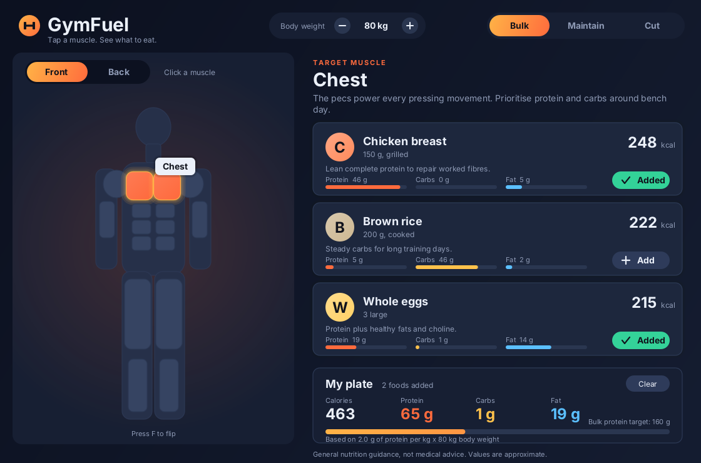
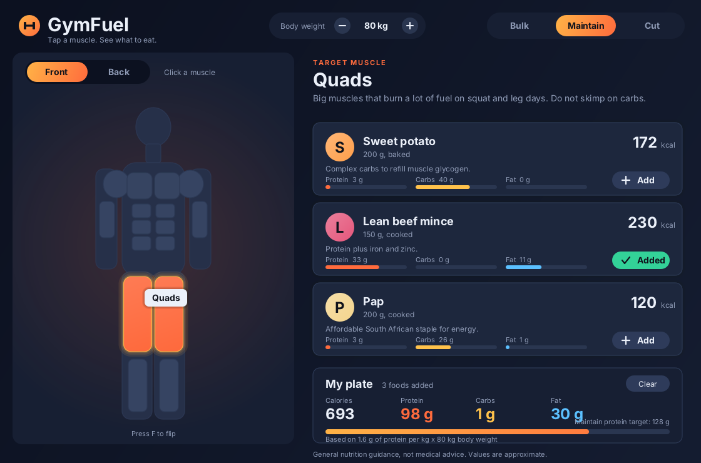
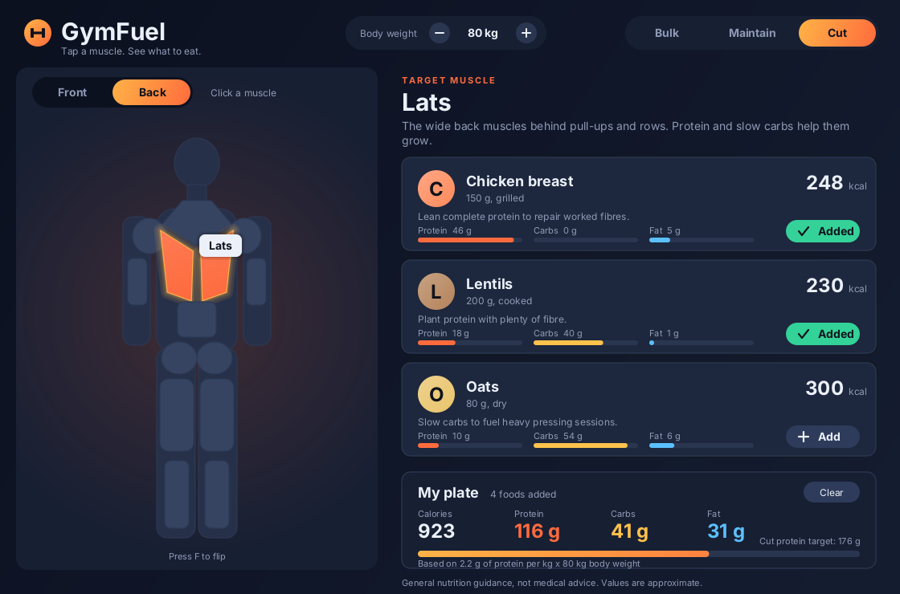
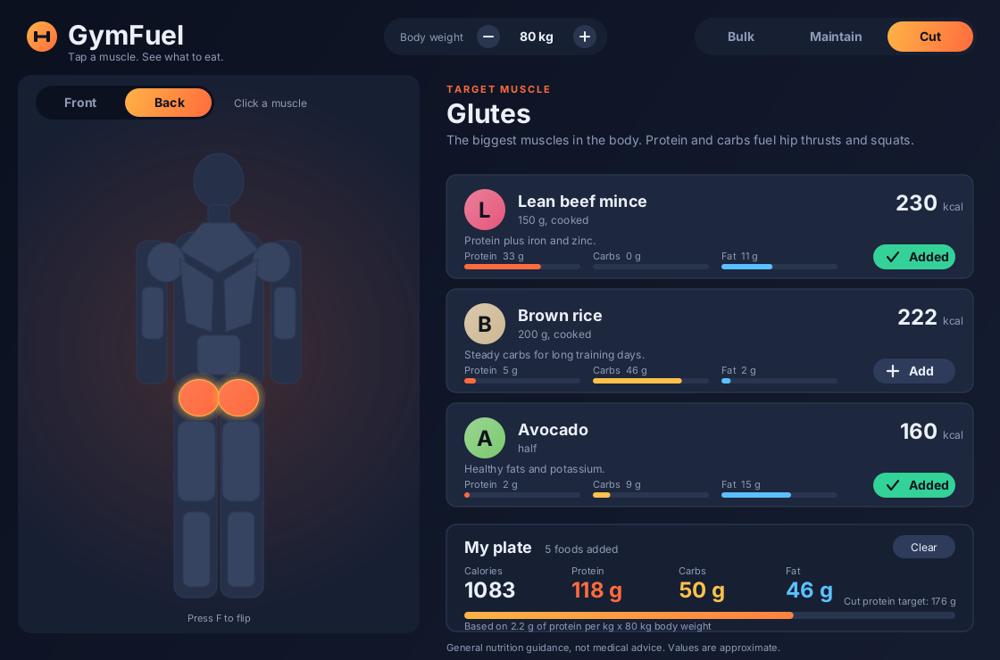
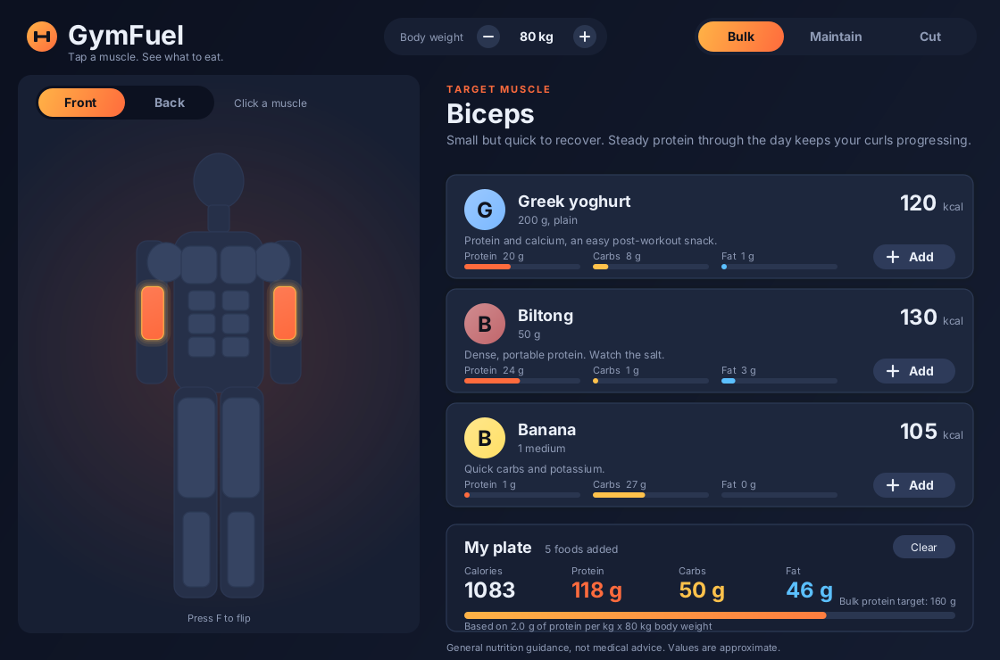

# GymFuel

**Tap a muscle. See what to eat.**

GymFuel is a Java desktop app that matches **muscle groups to the foods that fuel them**. Click a muscle on the body diagram, see food suggestions with calories, protein, carbs and fat, then build your plate and track it against a **Bulk, Maintain or Cut** protein target.

Built with plain Java (Swing and Java2D). No libraries, no installs, nothing to download.



## What it does

1. **Pick a muscle** on the body diagram (12 muscle groups, front and back).
2. **See what to eat** for it: three foods, each with calories and protein, carbs and fat bars.
3. **Build your plate** by clicking a food card or its Add button.
4. **Set your body weight.** Use the **-** and **+** buttons (hold to repeat) in the header. Your daily protein target is worked out from it.
5. **Track your goal.** Choose Bulk, Maintain or Cut and watch your plate total fill the protein target bar.

## How the protein target works

The target is **your body weight x grams of protein per kg**, and the goal sets the per-kg amount:

| Goal | Protein per kg | Example at 80 kg |
|---|---|---|
| Bulk | 2.0 g | 160 g |
| Maintain | 1.6 g | 128 g |
| Cut | 2.2 g | 176 g |

The orange bar under *My plate* shows how much of that target your plate covers. The default weight is 75 kg.

## Screenshots

| Quads, Maintain goal | Lats (back view), Cut goal |
|---|---|
|  |  |
| **Glutes (back view)** | **Biceps (front view)** |
|  |  |

## UI animation and micro-interactions

The interface is built around small animations that give instant feedback:

- Muscles ease into a hover colour, and the selected muscle pulses with a glow
- The body flips between front and back like a card
- A sliding highlight follows the Front/Back switch and the goal buttons
- Food cards slide in one after another, and the nutrient bars fill up
- Cards lift on hover, and the Add button turns into a check mark that draws itself
- Ripples on buttons, plate totals that count up, and a tooltip that fades in

All of it is drawn with Java2D and driven by a `javax.swing.Timer` with easing, so the app needs no extra libraries.

## Run it

You need **JDK 17 or newer**.

```
git clone https://github.com/SbahleKhuzwayo/GymFuel.git
cd GymFuel
javac GymFuel.java
java GymFuel
```

### Controls

| Action | How |
|---|---|
| Select a muscle | Click it on the body |
| Flip front / back | Click **Front / Back** or press `F` |
| Change goal | Click **Bulk / Maintain / Cut** or press `1`, `2`, `3` |
| Change body weight | Click **-** / **+** (hold to repeat) or press `Up` / `Down` |
| Add a food to your plate | Click the food card or **Add** |
| Empty the plate | Click **Clear** |

## Project structure

```
GymFuel/
├── GymFuel.java      the whole app (data, drawing, animation, input)
├── screenshots/      images used in this README
└── README.md
```

## Tech

- Java 17, Swing and Java2D
- Custom-painted UI with easing animations
- Data held in code: 12 muscle groups and around 20 foods with approximate nutrition values

## Disclaimer

Nutrition values are approximate and the protein targets are general guidance for healthy adults. This is not medical advice.

## Author

**Sbahle Khuzwayo**: [GitHub](https://github.com/SbahleKhuzwayo) · [LinkedIn](https://www.linkedin.com/in/sbahle-khuzwayob7a58423b)
